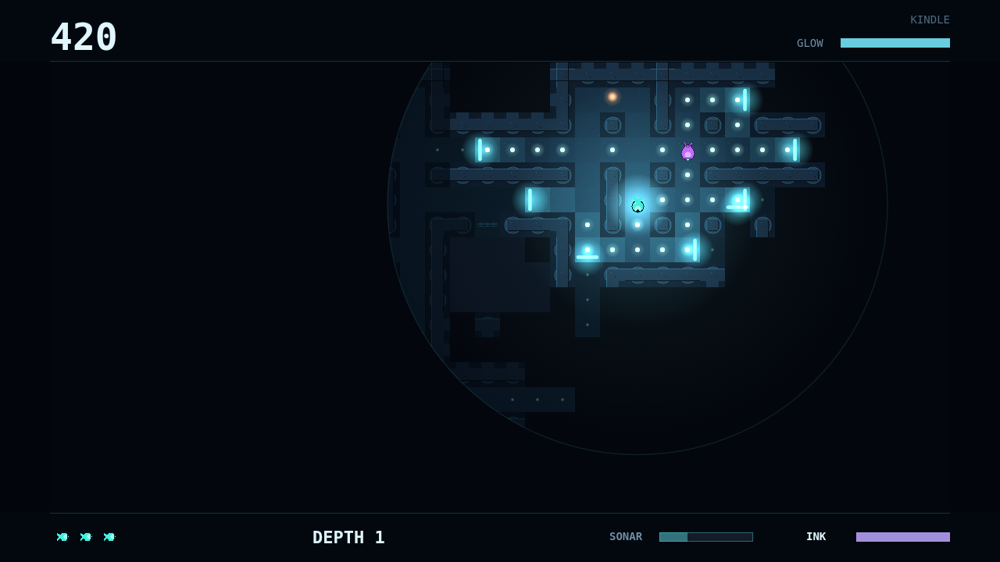
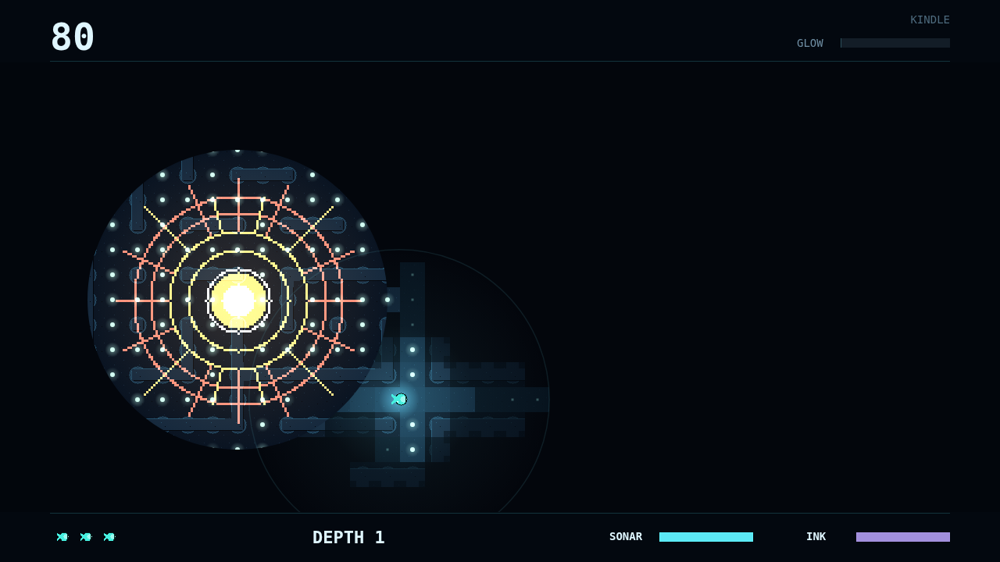

# Fathom

Fathom is a maze chase in the pitch-dark trench. You are a glimmerfin, a tiny
glowing forager, and every corridor of the maze is hidden until your own light
or a sonar pulse touches it. Graze every plankton mote to clear the maze, then
sink to a deeper, more crowded one.

A dive starts with almost nothing: a small pocket of light around you and a
circle of sight barely wider. Each plankton you eat makes you glow brighter and
widens that circle, so a run of good grazing opens the maze up around you.
Ground you have explored is remembered, but once you swim on it falls back into
darkness, and you find your way by memory, by the faint motes still waiting on
the floor, and by the sound of your own sonar flooding round the corners.

Three hunters share the trench, and each one finds you a different way. The
Lanternjaw hunts your light: the brighter you glow, the further it sees you,
and its amber lure looks exactly like the harmless drifters worth a fat bonus,
so every warm glimmer in the dark is a gamble. The Gloamfin is blind and hunts
by sound. It sweeps the maze with violet pings, it hears you if you swim too
close, and your own sonar tells it exactly where you were. The Flarefish shows
nothing at all until it flares, a blinding bloom that lights the maze around it
and locks onto anything caught inside.

So every choice is a trade. Eat and you see more, but you shine for the
Lanternjaw. Ping and you see the corridors and the hunters in them, but the
Gloamfin hears it. When something is closing, a cloud of ink blinds the
hunters that see and buys you a few seconds to slip away. Clear the maze and
the next one waits below, darker and busier, with a shorter sonar reach.
